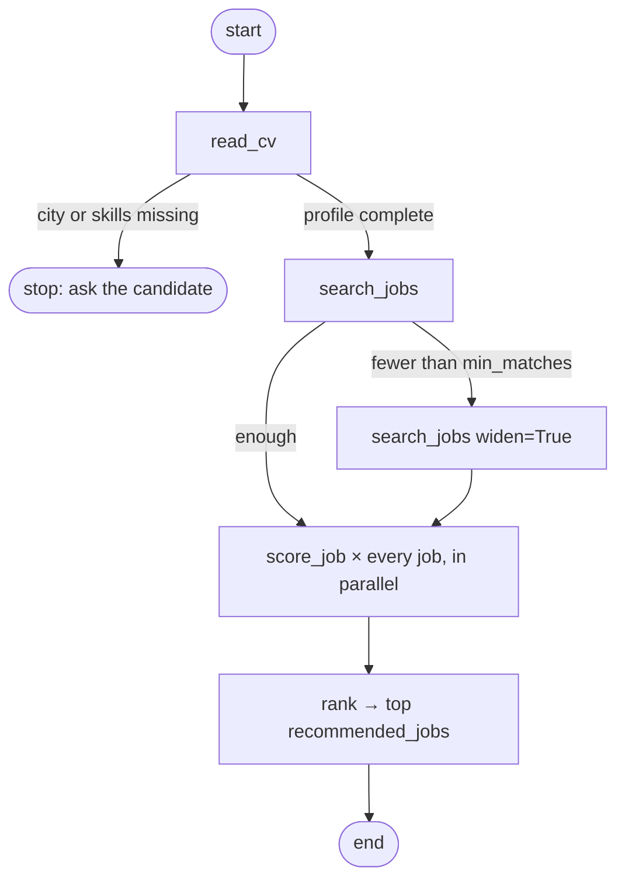
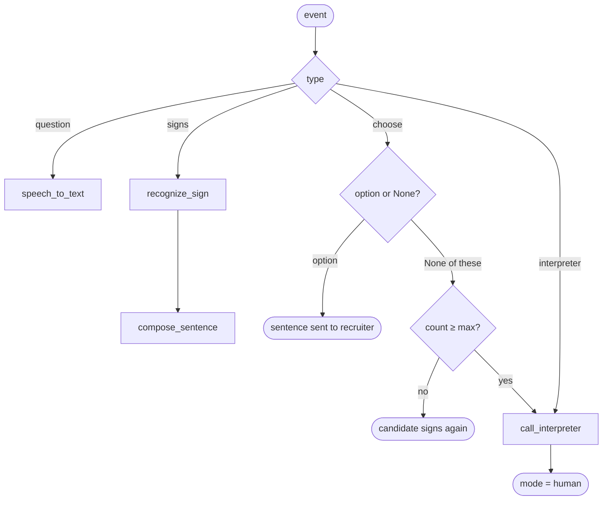

# Agents

Both agents are [LangGraph](https://langchain-ai.github.io/langgraph/) graphs. The graph calls the
tools in a fixed order; each tool is also exposed as a LangChain `StructuredTool` with a typed
parameter schema (`tools/__init__.py`).

Print a tool's parameters:

```python
from src.agent.job_agent.tools import read_cv_tool
print(read_cv_tool.args_schema.model_json_schema())
```

## Job Agent — `src/agent/job_agent/`



Entry point: `recommend_jobs(cv_file=..., answers=..., profile=...)` in `graph.py`.

| Tool | Required | Optional | Returns |
|---|---|---|---|
| `read_cv` | `cv_file` (.pdf, .docx, .txt, .md, .json) | | `{skills, major, experience_years, city}` |
| `search_jobs` | `profile` | `widen=False` | list of jobs |
| `score_job` | `profile`, `job` | | `{job_id, match 0-100, city, reason (Arabic), matched_skills, via}` |

**Search rules.** Normal search: jobs in the candidate's city (or remote) that share at least one skill.
Widened search: any job sharing a skill, plus remote jobs and jobs in nearby cities
(Jeddah ↔ Makkah, Dammam ↔ Khobar).

**Rule-based score.** 70% share of the job's skills the candidate has + 20% same city or remote +
10% experience (3+ years = full). Arabic and English names match (`تحليل البيانات` = `Data analysis`,
`الرياض` = `Riyadh`).

## Interview Agent — `src/agent/interview_agent/`

The graph runs **once per event**. `InterviewSession(session_id, mode)` keeps the state between events.

| Case | Mode | What happens |
|---|---|---|
| 1 · Human from the start | `human` | Only `speech_to_text`; the human interpreter conveys the signs. |
| 2 · AI only | `ai` | `speech_to_text` and `recognize_sign` (in parallel) → `compose_sentence` → the candidate picks option 1/2/3 or "None of these". |
| 3 · Switch to human | `ai → human` | The "I need an interpreter" button (any time), or "None of these" reaching `max_none_of_these` → `call_interpreter`, then continue as case 1. |



| Tool | Required | Optional | Returns |
|---|---|---|---|
| `speech_to_text` | `text_or_audio` | | question text |
| `recognize_sign` | `keypoint_segments` | `top_k=5` | per sign: `[{label_ar, score}]` |
| `compose_sentence` | `candidate_words`, `last_question` | | up to 3 Arabic sentences |
| `call_interpreter` | `session_id`, `reason` (`button` \| `none_limit`) | | `{session_id, reason, steps}` |

Events the agent ignores are answered with a `notice` instead of an error:
`human_mode`, `invalid_choice`, `no_signs_recognized`, `interpreter_already_called`, `unknown_event`.

## Fallbacks

| Step | With Claude (`ANTHROPIC_API_KEY` set) | Without Claude |
|---|---|---|
| `read_cv` | Claude extracts the profile | keyword rules (known skills, city names, "N years") |
| `score_job` | Claude gives match % and an Arabic reason | rule-based score and template reason |
| `compose_sentence` | Claude writes natural sentences | joins the recognised words, trying next-best words for variants |

Claude's replies are **validated**, never parsed by hand: `ask_claude(prompt, Schema)` in
`inference/llm.py` uses Claude's native structured output, and pydantic checks the result against
`CvProfileResponse`, `JobScoreResponse` or `SentenceOptionsResponse` (`src/agent/schemas.py`) — for
example `match` must be 0–100. If a Claude call fails or its reply is invalid, the tool falls back
automatically and logs `[FALLBACK]`.

## Shared types — `src/agent/schemas.py`

| Kind | Names |
|---|---|
| Enums | `Mode` (human, ai) · `EventType` · `InterpreterReason` (button, none_limit) · `Notice` · `MissingField` |
| Claude responses | `CvProfileResponse` · `JobScoreResponse` · `SentenceOptionsResponse` |
| WebSocket messages | `StartMessage` · `QuestionMessage` · `SignsMessage` · `ChooseMessage` · `InterpreterMessage` · `AudioEndMessage` (+ binary live audio) → replies `StartedReply` · `StateReply` · `CaptionReply` · `ErrorReply` |

The enums are `str` enums, so `Mode.AI == "ai"` and they appear in JSON as plain strings.

## Settings

See [Configuration](configuration.md): `job_agent.*` and `interview_agent.*` in `config.yaml`.
