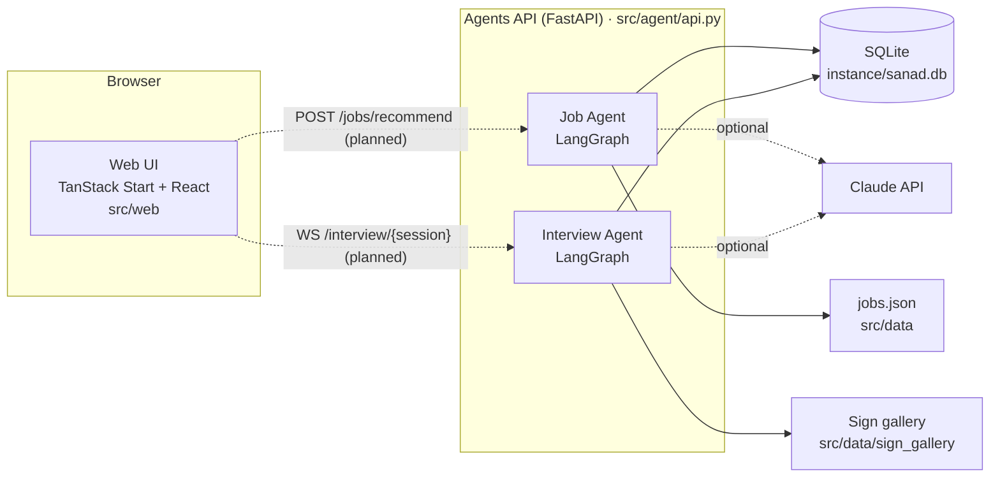
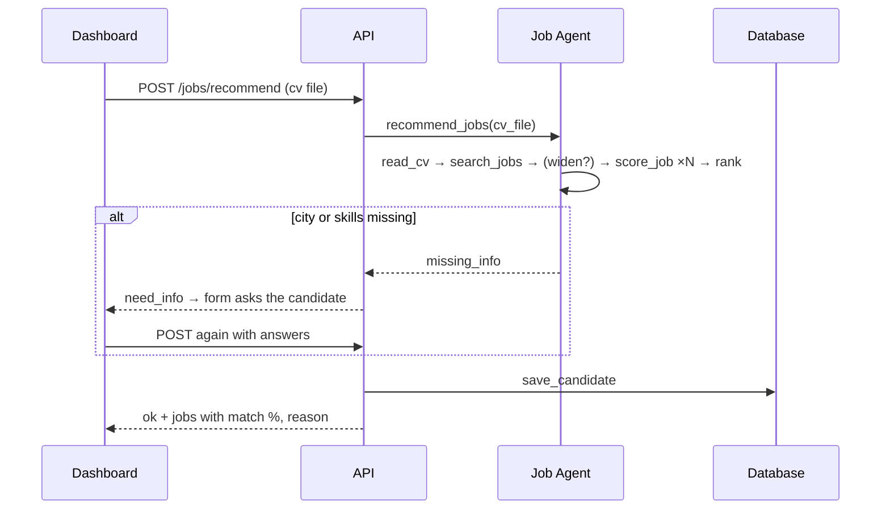

# Architecture

## Parts

| Part | Folder | Technology | Role |
|---|---|---|---|
| Web UI | `src/web/` | TanStack Start, React, Tailwind | Pages for candidates and employers (demo data; not connected to the API yet) |
| Agents API | `src/agent/api.py` | FastAPI, uvicorn | HTTP + WebSocket entry point; runs the agents |
| Job Agent | `src/agent/job_agent/` | LangGraph | CV → profile → matching jobs → ranked recommendations |
| Interview Agent | `src/agent/interview_agent/` | LangGraph | Recruiter speech → text; candidate signs → sentence options; interpreter switch |
| Inference | `src/agent/inference/` | Claude, numpy | LLM client, sign matching (DTW) |
| Speech | `src/agent/speech/` | Whisper Large-v3 (OpenRouter live, faster-whisper local), Silero VAD | Live microphone → Arabic captions → Interview Agent (Arabic only) |
| Shared types | `src/agent/schemas.py` | pydantic | Enums, validated Claude responses, WebSocket message models |
| Database | `src/database/` | SQLite | Candidates, jobs, interviews |
| Logger | `src/logger/` | logging | Shared, tagged logs with request ids |
| Data | `src/data/` | JSON, CSV, video | Jobs, sign gallery, Saudi Sign Language dataset |
| Runtime data | `instance/` | — | The database file (not in git) |
| Launcher | `run.py` | Python | setup / run / test in one command |

## Request flow: CV → recommended jobs

## Design choices

- **The graph decides the order, not the LLM.** Steps always run in the same order, so the result is
  predictable and works offline. Claude only improves individual steps (reading, scoring, wording).
- **Always a fallback.** Every Claude call has a rule-based fallback, so a missing key or a network
  error never breaks a demo. The log says which path ran (`[LLM]` or `[FALLBACK]`).
- **One state per interview.** The Interview Agent keeps each session's state in a LangGraph
  checkpointer, so counters such as "None of these" survive between events.
- **Privacy.** CV files are deleted right after reading; logs contain counts and ids only.
- **Front end and back end are separate.** The web UI (`src/web`) and the agents (`src/agent`) are
  independent; the dotted arrows above are the planned connection, through `docs/api.md`.
