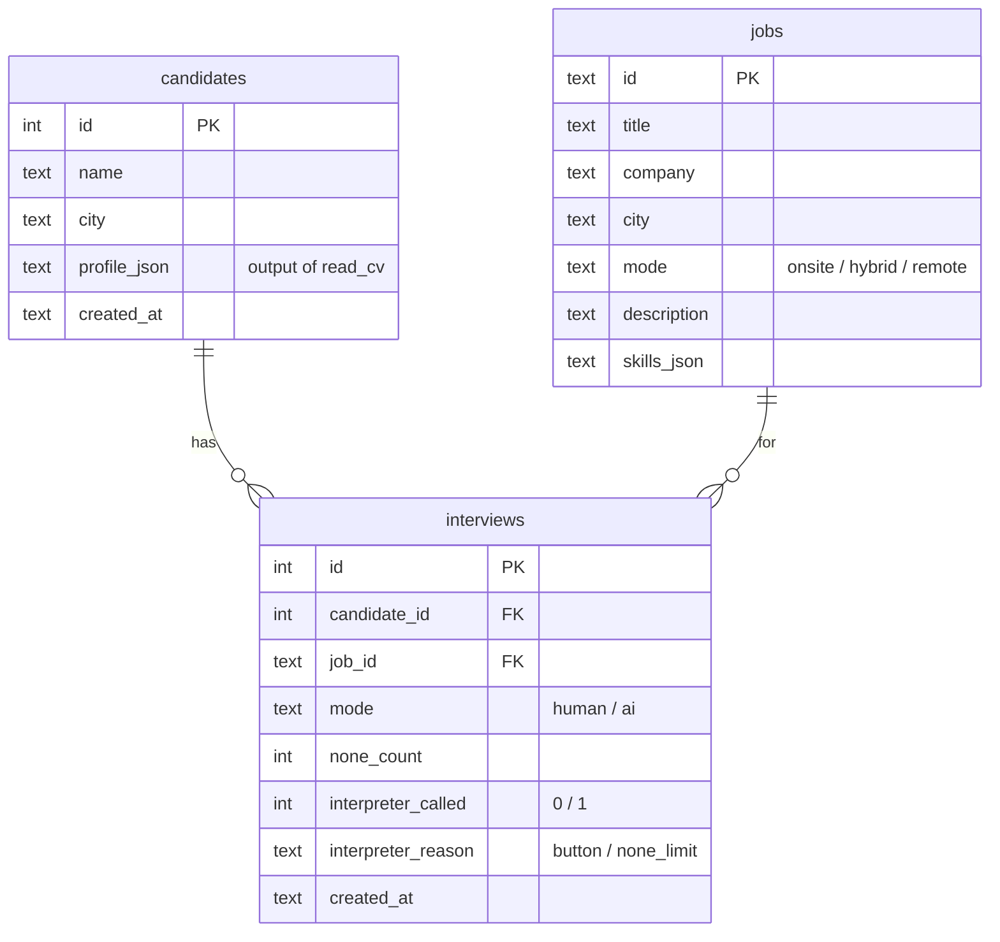

# Database

SQLite, file `instance/sanad.db` (set in `config.yaml` → `database.path`).

- Created automatically when the API starts (`init_db()`), together with the jobs from `src/data/jobs.json`.
- `instance/` is ignored by git: the file holds candidate profiles. Delete it any time to start fresh.
- Tests use a temporary database, never this file.

## Tables — `src/database/schema.sql`



## Functions — `src/database/db.py`

| Function | Used by | Does |
|---|---|---|
| `init_db()` | API startup | creates tables, loads `jobs.json` |
| `save_candidate(name, profile)` → id | `POST /jobs/recommend` | stores the candidate and extracted profile |
| `list_jobs()` | — | all jobs with skills as a list |
| `start_interview(candidate_id, job_id, mode)` → id | WebSocket start | creates an interview row |
| `update_interview(id, **fields)` | every WebSocket event | updates `mode`, `none_count`, `interpreter_called`, `interpreter_reason` |
| `get_interview(id)` | tests | one interview row |

Every function logs `[START]` / `[OK]` / `[FAIL]` (logger `database.db`).

## Looking inside

```bash
.venv\Scripts\python -c "import sqlite3; c = sqlite3.connect('instance/sanad.db'); print(c.execute('select * from interviews').fetchall())"
```

Or open the file with any SQLite viewer (for example the *SQLite Viewer* VS Code extension).
