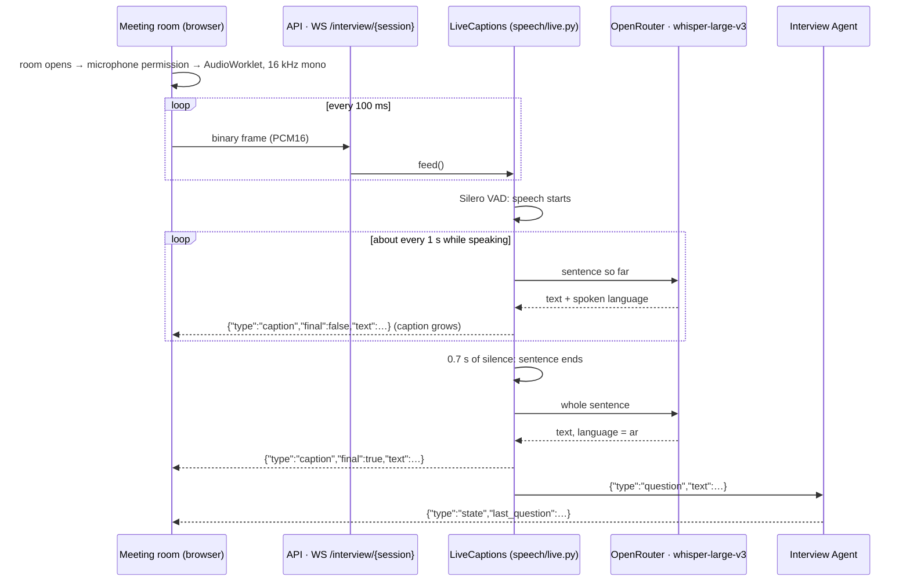

# Speech-to-text (Arabic only)

Two paths turn speech into Arabic text for the deaf candidate and the Interview Agent:

| Path | Used by | Engine |
|---|---|---|
| **Live captions** | the interview room (default) | Whisper Large-v3 on OpenRouter, `src/agent/speech/live.py` + `openrouter.py` |
| Recorded question (`audio_b64`) | API clients | local Whisper Large-v3, `src/agent/speech/speech.py` |

## Live captions

- Starts automatically when the candidate joins the room; the browser asks for microphone permission once.
  The toolbar microphone button mutes it (and finishes the sentence in progress); there is no record or send button.
- **OpenRouter has no streaming speech-to-text API** (its transcription endpoint takes a complete clip).
  Live captions therefore re-transcribe the sentence in progress about once a second
  (`speech.live.partial_interval_s`). A provider with a true streaming API can replace
  `LiveCaptions._transcribe` without changing the browser or the agent.
- Only finished sentences go to the Interview Agent; partial captions are display only.
- Key: `OPENROUTER_API_KEY` in `.env`, read on the server only (never sent to the browser, never logged).
- `provider.zdr = true`: only providers that do not retain the audio are used. Audio is not stored by Sanad.
- Measured on this project (synthetic Arabic voice, Edge, OpenRouter): first caption ~1.4 s after speech starts,
  refreshed ~1 s, final sentence ~1.5–2 s after the speaker stops; 3 of 3 Arabic sentences word-exact.

## Arabic only

- Live: Whisper reports the spoken language (`verbose_json`); a sentence is accepted only when it is Arabic.
  `language` is **not** forced to `ar`, because forced Arabic turns English speech into an invented Arabic
  paraphrase that cannot be detected (seen in testing). Whisper's `translate` task is never used.
- Local: `language="ar"` and `task="transcribe"` are fixed; a language-detection pass rejects clearly
  non-Arabic speech; `transcribe(..., language="en")` raises `ValueError`.
- Both: the text must be mostly Arabic script (`speech.min_arabic_ratio`), and phrases Whisper invents on
  silence ("ترجمة نانسي قنقر", "اشتركوا في القناة", …) are dropped.

## Errors (shown in Arabic in the meeting room)

| Code | When |
|---|---|
| `non_arabic_speech` | the sentence was not Arabic (it is not sent to the agent) |
| `speech_not_configured` | `OPENROUTER_API_KEY` is missing |
| `speech_service_unavailable` | OpenRouter unreachable, invalid key (401), no credit (402), rate limit (429) |
| `no_speech`, `invalid_audio`, `speech_model_unavailable` | local path (`audio_b64`) |

Browser side (`src/web/hooks/use-arabic-speech.ts`): microphone permission denied, no microphone,
microphone busy or unplugged, unsupported browser, connection lost (automatic reconnect), and a hint to
tap the page if the browser blocks audio until a click.

## Local Whisper

`pip install faster-whisper` (in `requirements.txt`). The model (~3 GB) downloads on first use. On a CPU
it takes 40–60 s per question, so it is not used for live captions. `SANAD_SPEECH_PRELOAD=1` loads it
when the API starts.
