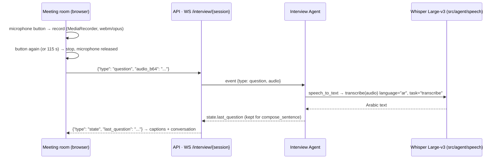

# Speech-to-text (Arabic only)

The recruiter's spoken question becomes Arabic text for the deaf candidate and for the Interview Agent.

## Arabic only

`src/agent/speech/speech.py` fixes everything in code:

- `language="ar"` on every call; Whisper's language detection is never used.
- `task="transcribe"`; Whisper's `translate` task (English output) is never used.
- `transcribe(..., language="en")` raises `ValueError`.
- Spoken-language gate: Whisper's language detector only *checks* the recording; speech confidently
  detected as another language (Arabic < 20 %) is rejected as `non_arabic_speech`. Without it, Whisper
  forced to Arabic turns English speech into an invented Arabic paraphrase (seen in testing).
- A transcript with no Arabic word, or less than `speech.min_arabic_ratio` (50 %) of its words in Arabic script, is rejected as
  `non_arabic_speech`. An Arabic sentence with a short foreign term ("خبرتك في Excel") is kept.
- Silence is removed with the built-in VAD, and phrases Whisper is known to invent on silence
  ("ترجمة نانسي قنقر", "اشتركوا في القناة", …) are dropped.

## Errors (shown in Arabic in the meeting room)

| Code | When |
|---|---|
| `no_speech` | nothing but silence/noise was recorded |
| `non_arabic_speech` | the speech was not Arabic |
| `invalid_audio` | the recording could not be decoded, or is longer than `speech.max_seconds` |
| `speech_model_unavailable` | `faster-whisper` is missing or the model could not load |

Browser-side errors (microphone permission denied, no microphone, microphone busy, no
`MediaRecorder`, server not reachable) are explained in Arabic by `src/web/hooks/use-arabic-speech.ts`.

## Running

`python run.py setup` installs `faster-whisper`. On the first start the model (~3 GB) downloads to
the Hugging Face cache; `run.py` loads it in the background when the API starts
(`GET /speech/status` shows `loading` → `ready`). On a CPU without a usable GPU, expect roughly
real-time or slower transcription (a 5 s question takes several seconds).

Privacy: the microphone is requested only when the button is pressed, and every track stops when
recording stops or the room is left. Audio goes only to the Sanad API and is not stored; logs
contain durations and character counts, not the text.

Live test: open <http://localhost:3000/interview?preview=true>, join, press the microphone button
in the toolbar, speak an Arabic question, press it again.
